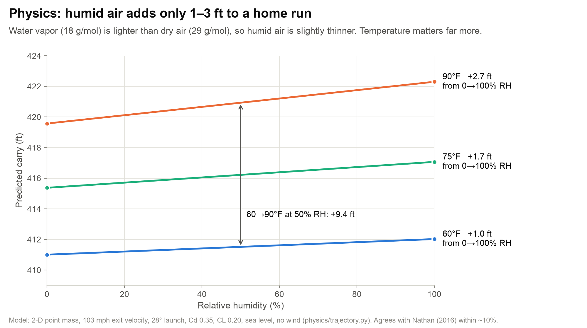
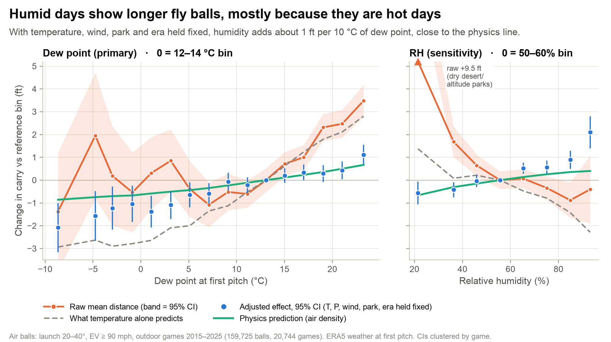
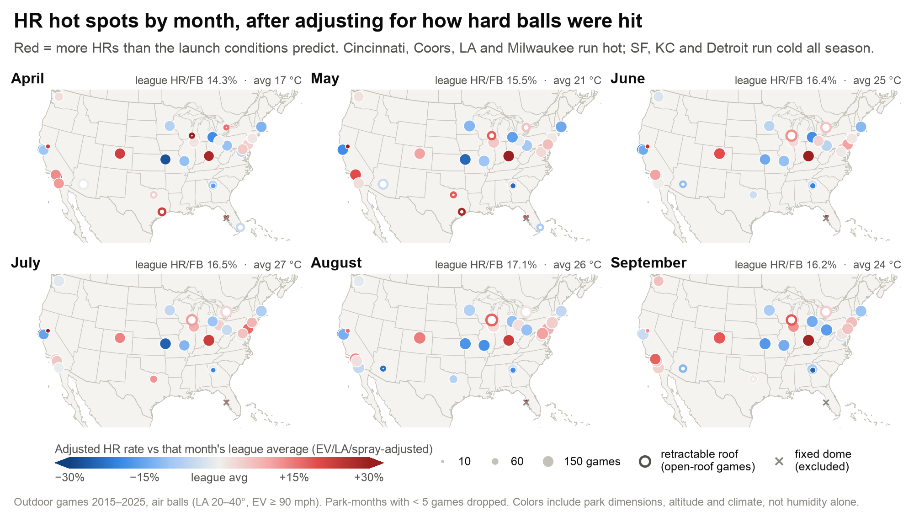
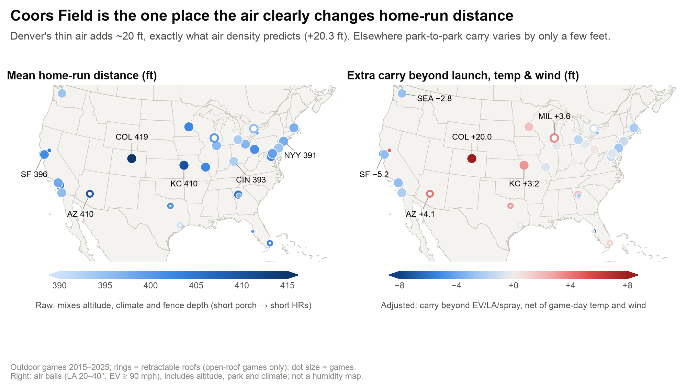
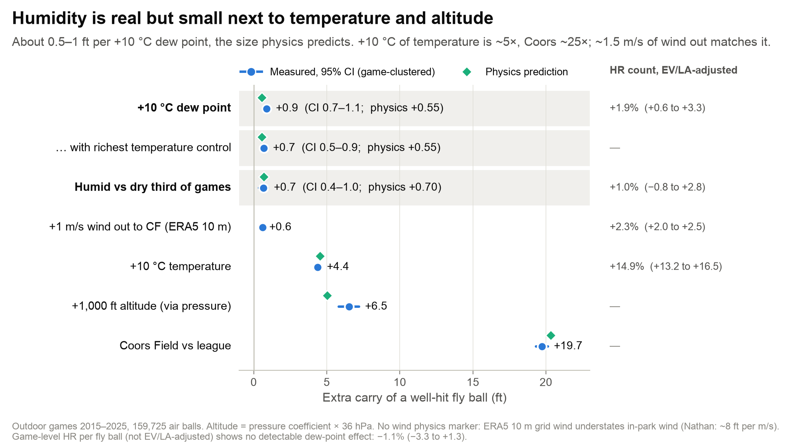
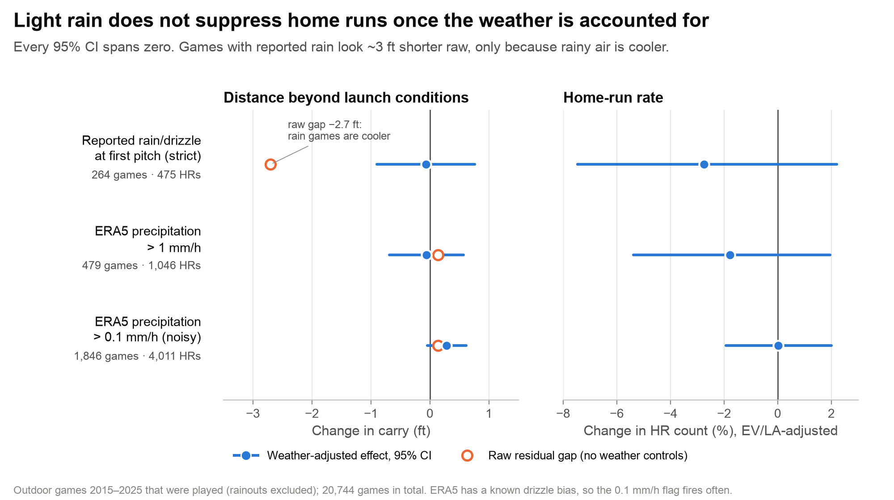

## Summary

**Humidity does make fly balls carry farther, but only by about 0.5–1 ft for every +10 °C of dew point.** That is the size and direction physics predicts: water vapour is lighter than the dry air it displaces. The effect shows up in carry measured beyond what exit velocity and launch angle predict. It does **not** show up in home-run counts: game-level HR per fly ball shows no detectable change. Temperature (+4.4 ft per +10 °C), altitude (+6.5 ft per 1,000 ft; Coors +19.7 ft) and wind matter far more. Light rain has no effect of its own once temperature is accounted for. Home-run hot spots by month are driven by parks and climate, not humidity.

## Question and data

This study asks five questions. (1) Pull every home run as far back as possible. (2) Are there more HRs on humid days? (3) Do HRs happen on lightly rainy days, and where are HRs hit most each month, adjusted for team quality? (4) Map average HR distance. (5) Plot HR distance against humidity.

Statcast distance begins in **2015**, so that is the floor. The dataset covers **25,193 regular-season games, 1.30 M balls in play and 63,419 HRs (2015–2025)**. Statcast HR totals match MLB's official totals for every year from 2015 to 2024. Each game is joined to ERA5 reanalysis weather (Open-Meteo) at the hour of scheduled first pitch: temperature, dew point, RH, surface pressure, precipitation and 10 m wind. ERA5 temperature agrees with the in-park temperature MLB reports at r = 0.96. The analysis uses outdoor games at real home parks: 20,744 games and **159,725 "air balls"** (launch 20–40°, exit velocity ≥ 90 mph, distance tracked), which hold 46,128 HRs.

## Physics expectation

At fixed temperature and pressure, water molecules (18 g/mol) replace N₂/O₂ (~29 g/mol), so humid air is less dense: Δρ/ρ ≈ −0.378·e/P. Going from 0% to 100% RH lowers density by 0.7–1.8% (60–90 °F). A drag-and-lift trajectory model shows that this adds **+1 to +3 ft** to a 415 ft home run (Fig. 1). Warming from 60 °F to 90 °F adds about 9 ft. The model matches Nathan's published values to within ~10%. Comparing the dry third of games with the humid third predicts only **~+0.7 ft (≈1.5–2% more HRs)**. That is just detectable in Statcast distances and not reliably detectable in HR counts.



## Method

Each adjustment removes something that could be confused with humidity.

- **Exit velocity and launch angle (team and batter quality).** Each ball's expected distance is predicted from EV × launch angle × spray. TrackMan (2015–19) and Hawk-Eye (2020+) get separate fits, since 2020 was a measurement break. The **residual** is how far the ball carried beyond what its launch implies. A stronger lineup hits the ball harder, but that goes into "expected", not the residual, so team quality drops out. The HR-count model also adds team-season fixed effects; the result does not change.
- **Park-period.** Each park gets its own baseline, split where fences moved. Weather is therefore compared day to day *within* a park, and altitude and fence distance cannot leak in.
- **Era.** Season × month fixed effects absorb the juiced (2016–19) and deadened (2021) balls, ball-lot drift and the humidor rollout.
- **Temperature, pressure and wind.** Humid days are hot days, and without a temperature control the "humidity" effect triples (2.6 ft). Every model holds ERA5 temperature, surface pressure, and wind projected onto the park's center-field bearing fixed. Humidity is measured as dew point, not RH, because RH falls as air warms even when moisture is unchanged.
- **Inference and benchmark.** SEs are clustered by game. The same regression is run on each game's density-predicted carry, which gives the physics benchmark under identical controls.

## Results

**Q5, distance vs humidity (Fig. 2).** Raw fly-ball distance rises about 5 ft from dry to humid games, and almost all of that rise follows temperature. With weather, park and era held fixed, carry rises **+0.89 ft per +10 °C dew point (95% CI 0.67–1.12)**, against a physics prediction of +0.55. The estimate depends on how temperature is measured. With the richest temperature control it is **0.69 (0.46–0.92)**, and that CI includes physics. The honest range is **~0.5–0.9 ft per 10 °C**. The humid third of games carries +0.68 ft (0.37–0.98) more than the dry third; physics predicts ≈ +0.7. RH (right panel) misleads raw: low-RH games are hot desert and altitude games.



**Q2, more HRs on humid days?** Not detectably. The EV/LA-adjusted logit gives **+1.9% HRs per +10 °C dew point (0.6–3.3)**, against 1.1–1.7% from physics. Humid vs dry tercile gives +1.0% (−0.8 to +2.8). Game-level HR per fly ball gives **−1.1% (−3.3 to +1.3)** with team-season fixed effects. The game-level model does not hold exit velocity fixed, and EV is 0.12 mph lower per +10 °C dew point (0.05–0.19), which cancels most of the air's gain. The game-level minimum detectable effect (~2–3%) is larger than the physics effect, so that null is uninformative rather than contradictory.

**Q3, where HRs are hit by month (Fig. 3).** Each dot is a park-month, colored by HRs relative to what the launch conditions of its air balls predict. That expectation removes batter and team quality. The pattern is stable across months: Cincinnati, Coors, Dodger Stadium and Milwaukee run hot; Oracle, Kauffman and Comerica run cold. That is a map of parks and climate, not humidity. League HR/FB rises from 14.3% in April to 17.1% in August as the air warms. The monthly league-level residual columns are blank on purpose: season × month fixed effects make them 0 by construction.



**Q4, HR distance by location (Fig. 4).** Mean HR distance ranges from about 391 ft (Yankee Stadium's short porch) to 419 ft (Coors). After removing launch, temperature and wind, **Coors carries +19.7 ft, against +20.3 ft predicted from air density alone**. Chase (+4.1) and Kauffman (+3.2) are next. Oracle (−5.2) and the other marine-layer parks are lowest.



**Effect sizes (Fig. 5).** On one scale, humidity is ~1/5 of a 10 °C temperature swing, roughly equal to 1.5 m/s of ERA5 wind out, and ~1/25 of Coors. Air density alone gives −1.41 ft per +1% (physics −1.35), so the data follow the density physics closely. As a placebo, outdoor dew point has no effect inside the sealed Tropicana dome (−0.02 ft, −1.49 to +1.44).



## Rain

Yes, HRs are hit on rainy days: 475 in the 264 games with rain or drizzle reported at first pitch. After weather controls, rain has no effect of its own (Fig. 6). Under the strict StatsAPI flag the effect is −0.07 ft (−0.90 to +0.76) and −2.8% HRs (−7.5 to +2.2). The ERA5 > 1 mm/h and > 0.1 mm/h flags agree. The raw −2.7 ft in reported-rain games comes from cooler air. Only games that were played are included.



## Skepticism and limitations

1. **Quote the range, not the point estimate.** The distance effect is "~0.5–1 ft per 10 °C dew point, consistent with physics". The +0.89 moves with how temperature is measured: 0.69 with the richest control, 1.36 with all weather interpolated to the inning.
2. **Per-park `mean_resid` is not a humidity map.** It includes altitude, park carry, ERA5 wind bias and climate. The within-park humid-minus-dry difference is noisy (SD ≈ 1.7 ft across parks).
3. **ERA5 is grid weather**, not stadium weather: ~30 km cells, 10 m wind, scheduled first-pitch hour. Coastal parks can be biased by land/sea mixing. That is one reason measured wind out (+0.6 ft per m/s) is far below Nathan's in-park values. Retractable roofs are assumed open unless reported closed, and closed retractable roofs still show outdoor-air leakage (+0.57 ft).
4. **Exploratory vs pre-registered.** Only the primary model is pre-registered: residual ~ dew point + T + P + wind + park-period FE + season-month FE, clustered by game. Everything else (terciles, splits, HR models, rain, maps) is exploratory, and many specs were run.
5. **The humidor and ball-moisture effect has the opposite sign and is larger.** A ball stored in humid air is heavier and less bouncy. Going from 30% to 50% storage RH costs ~13–14 ft and ~25% of HRs. Before all parks used humidors (2022), that worked against the air effect. The measured EV drop on humid days (−0.12 mph) may be its residue.
6. **Measurement and era breaks.** These include 2015 EV gaps, the 2020 switch from TrackMan to Hawk-Eye (TrackMan coefficient 0.58 vs Hawk-Eye 1.24), and ball changes that move league HRs ±15–20%, about 10× any humidity effect.

## Reproducing the figures

Every script reads only `analysis/results/` or `physics/` and runs in seconds from the repo root. Output goes to `figures/out/<same name>.png` (200 dpi, 10 × 5.6 in). Shared styling is in `figures/style.py`.

| Figure | Command (from repo root) |
|---|---|
| 1 Physics carry vs RH | `.venv/bin/python figures/fig01_physics_carry_vs_rh.py` |
| 2 Distance vs humidity | `.venv/bin/python figures/fig02_distance_vs_humidity.py` |
| 3 HR rate map by month | `.venv/bin/python figures/fig03_hr_rate_map_by_month.py` |
| 4 HR distance map | `.venv/bin/python figures/fig04_hr_distance_map.py` |
| 5 Effect sizes | `.venv/bin/python figures/fig05_effect_sizes.py` |
| 6 Rain | `.venv/bin/python figures/fig06_rain.py` |
| All six | `.venv/bin/python figures/make_all.py` |

Full rebuild from scratch, about 30 minutes the first time:

```bash
python3 -m venv .venv && .venv/bin/pip install -r requirements.txt
.venv/bin/python src/fetch_statcast.py --years 2015-2025
.venv/bin/python src/fetch_games.py --years 2015-2025
.venv/bin/python src/fetch_weather.py
.venv/bin/python src/build_dataset.py
.venv/bin/python -m analysis.run_all      # models + tables -> analysis/results/
.venv/bin/python physics/trajectory.py    # physics table
.venv/bin/python figures/make_all.py      # figures -> figures/out/
```

## References

- A. M. Nathan, *Using Statcast Data to Study the Flight of a Baseball* (2016). <https://baseball.physics.illinois.edu/THT-Fly-Ball-Distances-Statcast.pdf>
- A. M. Nathan, *Effect of Temperature on Home Run Production* (2017). <https://baseball.physics.illinois.edu/Effect%20of%20Temperature%20on%20Home%20Run%20Production.pdf>
- A. M. Nathan, *Home Runs and Humidors: Is There a Connection?* Baseball Prospectus (2011). <https://www.baseballprospectus.com/news/article/13057/baseball-proguestus-home-runs-and-humidors-is-there-a-connection/>
- A. M. Nathan, *Baseball at High Altitude* <https://baseball.physics.illinois.edu/Denver.html>; *Baseball Aerodynamics* <https://baseball.physics.illinois.edu/aero.html>
- A. M. Nathan et al., *The Effect of Spin on the Flight of a Baseball* (2006). <https://arxiv.org/abs/physics/0605041>
- Nathan, Smith, Faber & Russell, ball-moisture/humidor study (2011). <https://ar5iv.arxiv.org/html/1009.2549>
- A. M. Nathan, *A humidor at Chase Field* (THT, 2017). <https://tht.fangraphs.com/a-humidor-at-chase-field-whats-up-with-that>
- SABR, *Alan Nathan on Humidors and Home Runs* (2011) <https://sabr.org/latest/alan-nathan-on-humidors-and-home-runs/>; *Into Thin Air: Coors Field* <https://sabr.org/journal/article/into-thin-air-whats-all-the-fuss-about-coors-field/>
- Illinois Physics Van, *The Best Temperature for a Home-Run*. <https://van.physics.illinois.edu/ask/listing/938>
- Popular Science, best weather for home runs <https://www.popsci.com/best-weather-for-hitting-home-run-baseball/>; Nathan, Baseball Prospectus (2012) <https://www.baseballprospectus.com/?p=17249>
- Callahan, Dominy, DeSilva & Mankin, BAMS (2023), via Eos <https://eos.org/?p=208091> and Dartmouth <https://geography.dartmouth.edu/news/2023/04/climate-crisis-causing-more-home-runs-baseball>
- MLB, *Independent study of home run surge* <https://www.mlb.com/news/mlb-releases-independent-study-of-home-run-surge>
- AP via KSAT, *MLB standardizing ball rubbing and removal from humidors* (2022) <https://www.ksat.com/sports/2022/06/21/mlb-standardizing-ball-rubbing-and-removal-from-humidors/>; KING5/AP, MLB humidors <https://king5.com/article/sports/mlb-humidors-weather-impact-baseballs/281-bc328573-2988-426c-bb21-d82fd6d7345d>
- FanGraphs, *The Limitations of the Statcast Data* <https://blogs.fangraphs.com/the-limitations-of-the-statcast-data>; Baseball-Reference MLB totals <https://www.baseball-reference.com/leagues/majors/bat.shtml>
- D. Bolton, *The Computation of Equivalent Potential Temperature*, Mon. Wea. Rev. 108 (1980). [https://doi.org/10.1175/1520-0493(1980)108<1046:TCOEPT>2.0.CO;2](https://doi.org/10.1175/1520-0493(1980)108%3C1046:TCOEPT%3E2.0.CO;2)
- Data: Statcast via pybaseball <https://github.com/jldbc/pybaseball>; MLB StatsAPI; Open-Meteo ERA5 archive.
